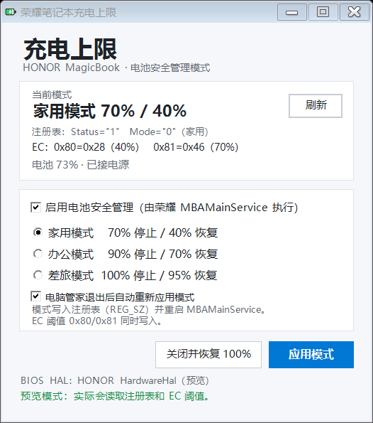

# HonorChargeLimit

> 荣耀 MagicBook 14 Pro 2025 电池安全管理 / 充电上限工具  
> A small Windows GUI for HONOR MagicBook battery-care modes.

[](https://www.microsoft.com/windows)
[](https://dotnet.microsoft.com/)
[](LICENSE)

---

## 免责声明

本项目与荣耀官方无隶属关系。

本项目不附带任何形式的明示或暗示担保，包括但不限于对适销性、特定用途适用性及非侵权性的担保。

在任何情况下，作者或贡献者均不对因使用或无法使用本项目而产生的任何直接、间接、偶然、特殊或惩罚性损害承担责任，包括但不限于数据丢失、利润损失或业务中断。

**使用风险自负。**  使用者有责任自行评估代码的适用性与安全性，并在部署前进行充分的测试。因使用本项目违反所在地法律法规的，由使用者自行承担全部责任。

本项目包含第三方依赖，其许可证与安全性由对应项目负责，作者不承担连带责任。

## 简介

这是从开源项目 **C-sharpEC / HonorPCManagerisJ8** 迁移而来的一个轻量工具，
用于在**荣耀 MagicBook 14 Pro 2025（32G + 1TB）**上切换荣耀电脑管家的
三种电池安全管理模式：

- 家用模式：70% 停止 / 40% 恢复
- 办公模式：90% 停止 / 70% 恢复
- 差旅模式：100% 停止 / 95% 恢复

程序不加载 WinRing0，不直接写 EC 端口 `0x66/0x62`，而是走荣耀官方链路：

```
注册表（REG_SZ） → MBAMainService → EC 模式标志 0x85/0x87/0x89
HardwareHal.dll（BIOS WMI 0x1003/0x1103） → EC 阈值 0x80/0x81
```

最终版本**会写 EC 值**（通过荣耀 `HardwareHal.dll` 的 BIOS WMI 接口写 `0x80/0x81`，
并由 `MBAMainService` 设置模式标志），但**不直接操作 EC 端口**。

> 本项目只针对该机型的寄存器/模式表做了适配。它使用了官方 HAL 和注册表，
> 比直接端口 I/O 更容易移植，但**不是所有荣耀笔记本通用**。移植说明见
> [docs/DEVELOPMENT.md](docs/DEVELOPMENT.md)。

---

## 功能

- 三种官方电池安全管理模式一键切换；
- 同时显示**注册表值**和 **EC 0x80/0x81 值**；
- 写入注册表（REG_SZ）并重启 `MBAMainService`，无需重启电脑；
- 支持“电脑管家退出后自动重新应用模式”：
  - 电脑管家退出时会把 EC 模式标志重置为关闭，但不会改注册表；
  - 本程序检测到它退出后会自动重新应用当前模式。
- 无驱动、无内核组件、无后台服务安装。



---

## 运行要求

- Windows 10 / 11 x64
- 已安装 **荣耀电脑管家**  (安装就行，不需要后台运行)
  - 需要 `C:\Program Files\HONOR\PCManager\HardwareHal.dll`
  - 需要 `MBAMainService` 服务
- 管理员权限（写注册表、重启服务、调用 BIOS WMI）
- .NET Framework 4.8（Windows 10/11 自带）

---

## 使用

1. 下载 [release/HonorChargeLimit-v1.6-win-x64.zip](release/HonorChargeLimit-v1.6-win-x64.zip)
   或直接使用 `dist/HonorChargeLimit.exe`。
2. 右键 `HonorChargeLimit.exe` → **以管理员身份运行**。
3. 勾选“启用电池安全管理”。
4. 选择家用 / 办公 / 差旅。
5. 点 **应用模式**。
   - 程序会写 EC 阈值、写注册表、重启 `MBAMainService`；
   - 服务启动后会设置 `0x85/0x87/0x89`。
6. 保持程序运行；建议保留“电脑管家退出后自动重新应用模式”。
7. 想恢复满充：点 **关闭并恢复 100%**。

> 每次应用/自动恢复会重启一次 `MBAMainService`，大约 2～5 秒。

### 命令行（管理员）

```bat
HonorChargeLimit.exe --read
HonorChargeLimit.exe --mode home
HonorChargeLimit.exe --mode office
HonorChargeLimit.exe --mode travel
HonorChargeLimit.exe --restore
```

---

## 模式与寄存器

| 模式 | 注册表 `PowerSafeManagerMode` | EC 0x80 | EC 0x81 | EC 0x85/0x87 |
|---|---|---|---|---|
| 家用 | `"0"` | `0x28`（40%） | `0x46`（70%） | `01` |
| 办公 | `"1"` | `0x46`（70%） | `0x5A`（90%） | `02` |
| 差旅（预计） | `"2"` | `0x5F`（95%） | `0x64`（100%） | `03` |
| 关闭 | `"0"` + Status `"0"` | `0x64`（100%） | `0x00` | `00` |

`0x89`：

- `1`：当前允许充电（电量低于模式上限）；
- `0`：当前禁止充电（电量高于模式上限）。

注册表：

```
HKLM\SOFTWARE\PCManager\MBAPowerManager
    PowerSafeManagerStatus = "1" / "0"      （REG_SZ）
    PowerSafeManagerMode   = "0" / "1" / "2"（REG_SZ）
```

> 必须是 **REG_SZ 字符串**，不要写成 DWORD。
差旅模式未在实机上逐一验证，`0x5F/0x64/03` 按官方模式表推断。(其实是作者用不上>_<)

---

## 验证

用 RWEverything 打开 EC，`EC_SC/EC_DATA = 0x66/0x62`：

办公模式应看到：

```
0x80 = 0x46
0x81 = 0x5A
0x85 = 0x02
0x87 = 0x02
0x89 = 0x01   // 电量低于 90% 时允许充电；到 90% 后变 0
```

家用模式：

```
0x80 = 0x28
0x81 = 0x46
0x85 = 0x01
0x87 = 0x01
0x89 = 0x00   // 电量高于 70% 时禁止充电
```

---

## 工作原理（简述）

荣耀电脑管家的电池安全管理不是单纯写两个阈值寄存器，而是：

1. UI 把模式写入注册表（REG_SZ）；
2. `MBAMainService` 读取模式，设置 EC 的 `0x85/0x87/0x89`；
3. `0x80/0x81` 保存当前模式的停止/恢复阈值；
4. `0x89` 根据电量与上限动态表示“允许/禁止充电”。

本程序按同样的顺序操作：

1. 通过 `HardwareHal.dll` 的 `HalSetInformation(8, 0, 12, ...)`
   （BIOS WMI `0x1003`）写 `0x80/0x81`；
2. 写注册表 `PowerSafeManagerStatus` / `PowerSafeManagerMode`；
3. 重启 `MBAMainService`；
4. 服务设置模式标志。

详细原理、开发过程、踩坑记录、为什么不能自定义充放电上下限，见
**[docs/DEVELOPMENT.md](docs/DEVELOPMENT.md)**。

---

## 兼容性

- 本项目按 **MagicBook 14 Pro 2025** 的 EC 寄存器（`0x80/0x81`）和模式表
  （家用/办公/差旅）适配。
- 其他荣耀笔记本如果 EC 寄存器、模式表、`HardwareHal.dll` 接口不同，需要单独适配；
  不能保证直接可用。
- 移植时先用 RWEverything 确认：
  - 阈值寄存器地址；
  - 模式标志 `0x85/0x87/0x89` 的含义；
  - 注册表 `MBAPowerManager` 是否存在、值类型是否 REG_SZ；
  - `HardwareHal.dll` 是否导出 `HalInit/HalQueryInformation/HalSetInformation`。
- 由于使用了官方 HAL/注册表，而不是硬编码端口 I/O，移植工作量通常小于直接写 EC。

---

## 构建

需要 Windows 自带的 .NET Framework 4.x 编译器（无需 Visual Studio）：

```powershell
powershell -ExecutionPolicy Bypass -File .\build.ps1
```

输出：`dist\HonorChargeLimit.exe`（以及 `dist\README.txt`）。

源码结构：

```
src/
  Program.cs                 入口、命令行、UAC 提升
  MainForm.cs                模式界面、注册表/EC 显示、电脑管家退出自动恢复
  PowerManagerConfig.cs      REG_SZ 注册表 + 重启 MBAMainService
  HalChargeController.cs     HardwareHal 的 BIOS WMI 读写
  BatteryInfo.cs             电池电量/电源状态
  AssemblyInfo.cs
  app.manifest
  icon.ico
```

---

## 已知限制

- 只支持三种官方模式，**不支持自定义上下限**（原因见 docs/DEVELOPMENT.md）。
- 需要荣耀电脑管家；卸载后 `HardwareHal.dll`/`MBAMainService` 可能不存在。
- 关闭电脑管家会重置 EC 模式标志；本程序运行时可以自动恢复，程序关闭后需要重新打开并点一次“应用模式”。
- 每次切换模式会重启 `MBAMainService`，有 2～5 秒延迟。
- 本项目不是荣耀官方项目，与荣耀无隶属关系。

---

## 免责声明

修改电源模式会影响充电行为。虽然本工具走的是荣耀官方 HAL/服务路径，
仍建议插电测试、逐步验证。因使用本工具造成的电池、主板或数据问题，
由使用者自行承担。

---

## License

[MIT](LICENSE)

